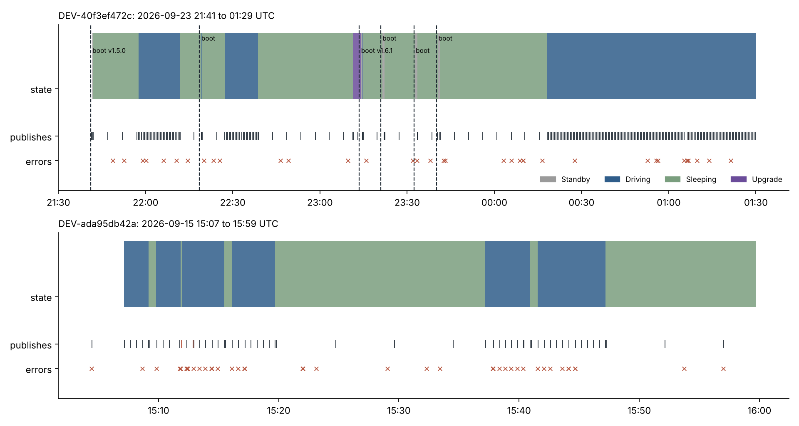
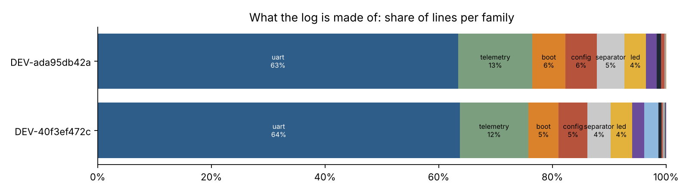

# eld-device-log-parser

**Turn 85,000 lines of ELD firmware log into event tables, and find out what the device was actually doing.**

[](https://github.com/JacobCCMorgan/eld-device-log-parser/actions/workflows/ci.yml)

An electronic logging device is a small Linux computer that polls a micro-controller for engine and GPS data
over a serial port, drives a Bluetooth module over another, and publishes a telemetry record to the backend
every 30 seconds while the truck moves. When support or engineering pull its log, they get tens of thousands of
lines of byte dumps, return codes and operator messages, and the questions they need answered (when did it enter
Driving, did every upload get acknowledged, what happened while it was offline, why did it raise an ECM-disconnect
event) are buried in the 1 % of lines that matter.

This repository is a parser and an analysis of two real logs: a customer truck (2020 Freightliner, J1939) across
3.8 hours and an over-the-air firmware update, and the vendor's OBD-II test vehicle across one hour. The logs are
de-identified and normalized to English before publication (`data/SOURCE.md`); the device keys join to the
[`telematics-data-foundation`](https://github.com/JacobCCMorgan/telematics-data-foundation) tables.

## Findings

- **The parser classifies 100 % of 85,331 lines with 80 patterns in 14 families** and produces nine event tables:
  boot sessions, state transitions, uploads with matched acknowledgements, serial round-trips, sensor readings,
  configuration reads and writes, errors, offline-queue events and backend API calls.
- **73 % of the log carries no operational information**: 64 % is serial-bus traffic (byte dumps, command codes,
  return codes), the rest LED control, Bluetooth housekeeping and decorative separators. State changes, errors,
  OTA and offline buffering together are under 1 % of lines. Moving the byte dumps behind a debug flag would cut
  the daily 2 MB archives by about three quarters.
- **Uploads behave as specified and the offline path works.** Driving telemetry goes out every 30 s and sleeping
  status every 5 min; 300 of 304 publishes were acknowledged, 98 % or more within one second. The three
  unacknowledged telemetry records each coincided with a broker `connection reset by peer`; the device timed out
  after 5 s, wrote the record to its re-upload folder, reconnected and re-sent it as `is_stored = 1`, and the backend
  acknowledged the copy 10 to 32 s after the original attempt. Nothing was lost or duplicated.
- **The ECM-disconnect event (ERR005) is a false positive on OBD-II.** On the test vehicle, speed, RPM, odometer
  and VIN were present in every cycle, but engine hours never were (the vehicle does not expose that PID). The
  firmware's rule fires on *any* missing field, so it logged "GPS speed > 0 but ECM field contains N/A, send
  ERR005" 22 times in an hour on a vehicle whose ECM was fully connected; a one-hour cooldown suppressed 21 and one
  event reached the backend. The J1939 truck, the kind of unit the rule was written for, raised none. Fix:
  evaluate ERR005 on speed and RPM only.
- **The truck rebooted five times in 3.8 hours.** One was the OTA update from v1.5.0 to v1.6.1 (160 s in the
  Upgrade state, success reported). The other four were unannounced, and three sessions of 7 to 11 minutes
  followed the update before a stable 110-minute session. One device cannot say whether this is a post-update
  watchdog loop or external power; it is the first thing to check fleet-wide after a rollout.
- **Serial buses are healthy but chatty.** 8,598 request/reply round-trips, all answered within the one-second log
  resolution; 50 ST-controller requests (1.0 %) timed out and were retried, spread across every command rather
  than concentrated on one. The LED colour command alone is 1,860 round-trips, two to three per telemetry cycle.
- **"VIN not yet detected" is parked trucks, not broken installs.** The ECM only answers with the engine running;
  on the truck the first payload carrying a VIN came 17 minutes after boot, once the engine started, and while
  Sleeping 54 % of ECM query cycles returned no VIN after three retries. The foundation tables' 40 % of devices
  that "never read a VIN" should be read with this in mind.
- **Hand-written patterns agree with unsupervised template mining.** Drain3 finds 316 templates on the same lines
  and needs 146 of them to cover 99 %; every Drain cluster falls inside exactly one of the registry's families
  (weighted purity 1.00). Drain is the discovery tool after a firmware release; the registry is what you ship,
  because its parameters have names.

Full write-up with figures: [`reports/firmware_log_report.md`](reports/firmware_log_report.md).




## What the tables let you ask

| table | one row per | typical question |
|---|---|---|
| `boot_sessions` | power-on or restart | how often does it reboot, how long to first publish, signal at boot |
| `state_transitions` | state-machine flow start | time in Driving / Sleeping, what triggered each change |
| `uploads` | MQTT publish | cadence, ack latency, stored re-sends, payload fields over time |
| `uart_commands` | serial request / reply | round-trip latency, timeouts and retries per command and bus |
| `readings` | sensor reading per cycle | which ECM fields go missing, in which state |
| `config_io` | /config key read or write | sequence numbers, engine-hour compensation, mode changes |
| `errors` | error line or ERR event | ERR005 attempts vs suppressions, ack timeouts, connection losses |
| `upload_queue` | offline buffering event | fallback writes and re-upload batches |
| `api_calls` | backend REST call | login / time-sync latency |

## Method

1. **Read**: the Go logger prefix (`Level :YYYY/MM/DD HH:MM:SS body`) is split off; levels are Info, Consol
   (console mirror), Error and ELD (shell scripts).
2. **Classify**: an ordered registry of 80 regular expressions (`src/eldlog/patterns.py`) assigns each line a
   pattern name, a family and named parameters. Specific patterns (state flow, boot, errors) precede generic
   ones (serial dumps); unmatched lines are counted as `other` and reported as parser coverage (0 here).
3. **Build tables** (`src/eldlog/tables.py`): sessions are cut at the boot shell scripts; transitions take the
   nearest preceding trigger line; publishes are matched to acknowledgements by the payload timestamp the ack
   echoes, preferring the same `is_stored` flag so that a re-sent record is credited rather than the original;
   serial traffic is paired per bus because the BLE and ST goroutines interleave, and unsolicited module
   notifications are kept as a separate direction.
4. **Metrics and figures** (`src/eldlog/metrics.py`, `report.py`): composition, cadence, ack latency, offline
   recovery, round-trips per command, state time, ECM field gaps, ERR-event throttling, session table.
5. **Template mining** (`src/eldlog/drain.py`): Drain3 on masked lines; purity of its clusters against the
   registry's families.
6. **Publication step** (`src/eldlog/normalize.py`): phrase normalization and de-identification with the same
   keyed pseudonyms as the foundation tables; run once before a log enters the repository.

## Repository layout

```
data/logs/              two normalized, de-identified logs (gzip); data/samples/ plain-text excerpts; data/SOURCE.md
src/eldlog/reader.py    line reader (plain or gzip), prefix parsing
src/eldlog/patterns.py  the 80-pattern registry and classify()
src/eldlog/parse.py     lines table and coverage
src/eldlog/tables.py    the nine event tables
src/eldlog/metrics.py   device-observability metrics
src/eldlog/drain.py     Drain3 comparison
src/eldlog/report.py    figures and the Markdown report
src/eldlog/normalize.py publication step (needs the private phrase map and key)
src/eldlog/cli.py       eldlog parse | report | normalize
reports/                generated: report, 7 figures, Parquet tables, metric CSVs, summary.json
tests/                  81 tests: one fixture per line family, table construction on a synthetic log,
                        de-identification rules, invariants on the published logs
```

## Reproduce

```bash
git clone https://github.com/JacobCCMorgan/eld-device-log-parser.git
cd eld-device-log-parser
python -m venv .venv && source .venv/bin/activate
pip install -e ".[dev]"
pytest -q                                            # about 10 s
eldlog report data/logs/*.log.gz --out reports       # tables, metrics, figures, report; about 10 s
eldlog parse  data/logs/*.log.gz --out my_tables     # tables only
```

To parse a new log from the same firmware family: `eldlog parse yourlog.txt`. Lines the registry does not know
show up as `other` in `coverage.csv`; add a pattern to `patterns.py` and a fixture to `tests/test_patterns.py`.

## Limitations

- Two devices, one session each. Rates describe these sessions, not the fleet; the reboot pattern in particular
  needs more units before it is a finding about the firmware.
- One-second timestamps; sub-second latencies read as 0 or 1 s. The device clock steps backwards when it re-syncs.
- Wake-up reason codes and the ST command set are interpreted from the log alone, without the firmware source.
- Byte dumps that carried identifiers were rewritten during de-identification; their checksum bytes no longer verify.

## License

MIT for the code; the log files are released under the terms in `LICENSE` (no re-identification).
