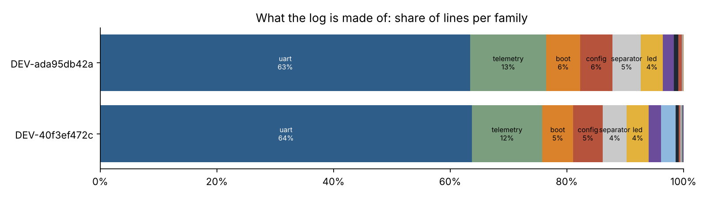
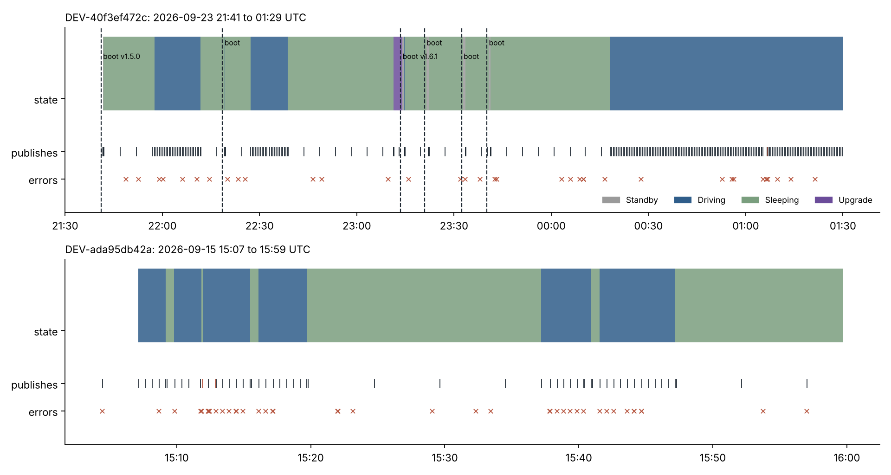
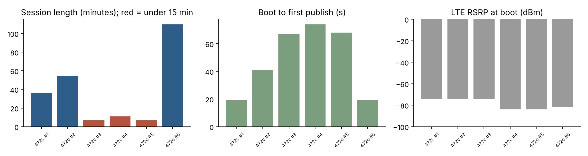
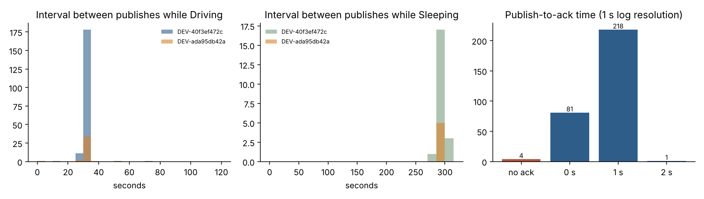
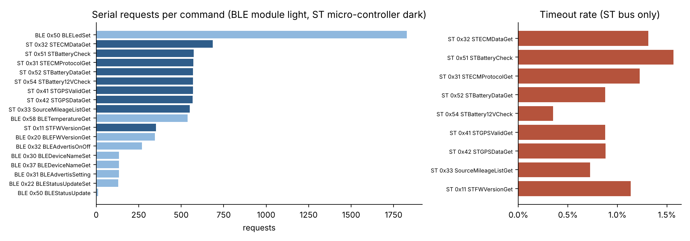
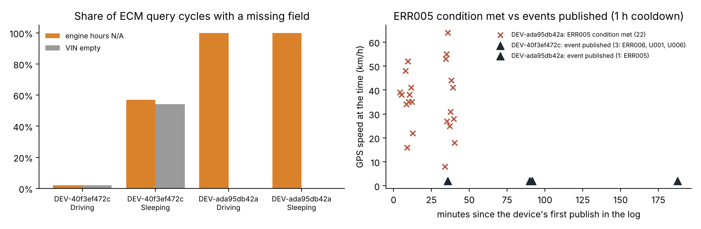
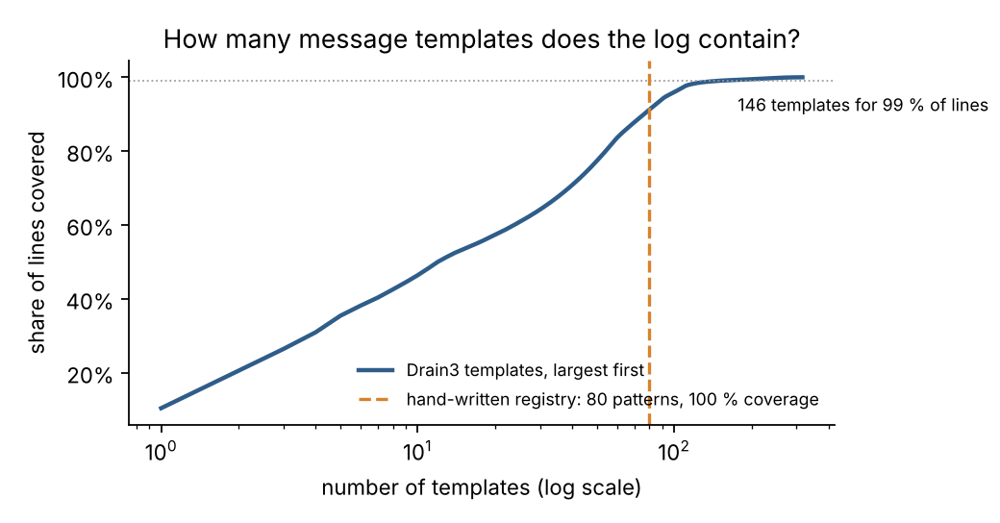

# Firmware log parser: results

Computed by `eldlog report`; every number is regenerated from the two published logs in `data/logs/`.

## 1. What the logs are

| device | vehicle (from the foundation tables) | log window (UTC) | lines | boots | publishes |
|---|---|---|---:|---:|---:|
| `DEV-40f3ef472c` | 2020 Freightliner, customer unit, J1939 bus | 2026-09-23 21:41 to 01:29 | 69,692 | 6 | 246 |
| `DEV-ada95db42a` | 2025 passenger vehicle, vendor test unit, OBD-II build | 2026-09-15 15:00 to 15:59 | 15,639 | 0 | 58 |

The parser classifies **100 % of the 85,331 lines** with 80 hand-written patterns in 14 families and turns them into nine event tables (`reports/tables/`).

## 2. What the log is made of

- **64% of all lines are serial-bus traffic** (byte dumps, command codes and return codes between the Linux host, the BLE module and the ST micro-controller); with LED control, BLE housekeeping and decorative separators the share of lines that carry no operational information rises to **73%**.
- The remaining lines are telemetry readings (12 %), configuration reads and writes (5 %), boot sequences (5 %), MQTT traffic (2 %) and under 1 % for the state machine, errors, OTA and offline buffering combined. Everything a support engineer actually looks for lives in that last 1 %.
- Recommendation: move byte dumps and LED/BLE chatter behind a debug flag. The file shrinks by about 73% and a day of logs would no longer force the 2 MB daily tar archives seen in the housekeeping lines.

## 3. Timeline: states, publishes, reboots

- The state machine behaves as documented: **Standby at boot, then Driving, and Sleeping once GPS speed is below 8 km/h with speed and RPM idle**; the device wakes to Driving on RPM or speed. `DEV-40f3ef472c` spent 80% of the observed time Sleeping, `DEV-ada95db42a` 49%.
- **`DEV-40f3ef472c` rebooted 5 times in 3.8 hours.** One reboot was the over-the-air update from v1.5.0 to v1.6.1 (Upgrade state lasted 160 s, upload before and after, UPS output "Success"). The other 4 were not announced: the log ends mid-cycle in Sleeping and the next lines are the boot shell scripts. 3 of the sessions lasted under 15 minutes, all right after the update; the wake-up reason codes the ST controller reports are 10, 08, 40, 08, 00, 10. Whether this is a post-update watchdog loop or external power cycling cannot be decided from one device; it is the first thing to check on the fleet after a firmware rollout.
- Boot is fast and consistent: 11 s init, 222 ms self-test, MQTT connected 13 s after boot, first publish 19 to 74 s after boot (the longer waits are the Standby flow retrying until GPS and ECM are ready). LTE RSRP at boot ranged -84 to -74 dBm.
- The VIN is not available until the engine answers: the first publish carrying a VIN came 17 min after the first publish on `DEV-40f3ef472c` and 3 min on `DEV-ada95db42a`; until then payloads carry the placeholder, which is what the foundation tables count as "never read a VIN".

## 4. Upload cadence, acknowledgements and offline recovery

| device | state | publishes | interval median (s) | p10 to p90 (s) | max (s) |
|---|---|---:|---:|---:|---:|
| `DEV-40f3ef472c` | Driving | 193 | 30 | 30 to 30 | 71 |
| `DEV-40f3ef472c` | Sleeping | 21 | 293 | 289 to 302 | 302 |
| `DEV-ada95db42a` | Driving | 39 | 30 | 30 to 32 | 52 |
| `DEV-ada95db42a` | Sleeping | 5 | 293 | 291 to 295 | 297 |

- **Driving telemetry is published every 30 s and sleeping status every 5 min**, exactly as specified; the long maxima are the reconnection gaps discussed below.
- **300 of 304 publishes were acknowledged by the backend, 98% or more of them within one second** (the log has one-second resolution, so this is an upper bound on latency). The backend REST calls made at boot take about 622 ms each by comparison.
- **The offline path works end to end.** Of the 4 unacknowledged publishes one is the device's own acknowledgement of the OTA command, which expects no reply. The other 3 were telemetry: each coincided with a `connection reset by peer` from the broker, the device waited 5 s (`WaitForAck` timeout), wrote the record to the re-upload folder, reconnected, re-sent it with `is_stored = 1` and received an acknowledgement that names the original payload timestamp. Delivery delay for the three records: 13, 10, 32 s. No record was lost and no record was duplicated at the broker (the original publish had no ack).

## 5. Serial buses: the host talks to two micro-controllers

- **8,598 request / reply round-trips**, 3,574 to the BLE module and 5,024 to the ST controller that owns the CAN/OBD, GPS and battery interfaces. Every BLE request was answered; **50 ST requests timed out (1.0%)** and were retried with the firmware's "spilled FF" mismatch logic. Timeouts spread across all ST commands rather than concentrating on one, which points at bus contention or controller load rather than a broken feature.
- All round-trips complete within the one-second log resolution. The LED colour command (BLE 0x50) alone is 1,860 of the round-trips: the LED is re-set two to three times per telemetry cycle.
- The BLE module pushes 264 unsolicited status notifications (command 0x23) that the host acknowledges; a parser that pairs frames strictly as request / reply mislabels those, so the parser treats them as a separate direction.

## 6. ECM data gaps and the ERR005 event: a false positive on OBD-II

- On the J1939 truck (`DEV-40f3ef472c`) the ECM answers whenever the engine runs: in Driving only 2% of cycles lack engine hours and 2% lack a VIN. While Sleeping (engine off) 57% of cycles lack engine hours and 54% the VIN, each time after three retries; the firmware then compensates the engine-hour value from its last stored reading (50 occurrences). This is the mechanism behind the "VIN not yet detected" rows in the fleet tables: parked trucks, not broken installs.
- On the OBD-II vehicle (`DEV-ada95db42a`) **engine hours are missing in 100 % of cycles while speed, RPM, odometer and VIN are all present**: the vehicle simply does not expose an engine-hours PID.
- The firmware's ECM-disconnect rule fires on *any* missing field. Result: **22 times in 60 minutes the device logged "GPS speed > 0 but ECM field contains N/A, send ERR005"** on a vehicle whose ECM was fully connected; a one-hour cooldown suppressed 21 of them and 1 ERR005 event reached the backend. The `DEV-40f3ef472c` truck, which is the kind of unit the rule was written for, raised none.
- Two consequences for the fleet-level analysis in `eld-ecm-disconnect`: the per-report anomaly flags are not throttled, but ERR005 *events* are (at most one per device-hour), so event counts under-state the problem by design; and OBD-II units flagged as chronic deserve a check of *which* field is missing before anyone is sent to the vehicle. Recommended fix: evaluate ERR005 on speed and RPM only, and treat engine hours as optional for OBD-II protocol builds.

## 7. Hand-written patterns versus automatic template mining

Drain3 (depth 4, similarity 0.4) was run on the same lines after masking numbers, hex dumps, identifiers and JSON.

| | Drain3 | registry |
|---|---:|---:|
| templates / patterns | 316 | 80 |
| lines covered | 100 % (by construction) | 100 % |
| templates needed for 99 % of lines | 146 | 80 (all) |
| singleton templates | 31 | 0 |
| clusters that mix registry families | 0 | - |

- Drain agrees with the registry: **weighted purity 1.00**, i.e. no Drain cluster contains lines from two different registry families. The registry is the unsupervised structure plus semantics.
- Drain needs 146 templates to reach 99 % of lines because it splits one logical message into variants by parameter position (the per-state `[Driving][query ...]` family alone becomes 39 templates). Drain is the right tool to discover an unknown log and to catch new message types after a firmware release; the registry is what you ship, because its parameters have names.

## 8. Limitations

- Two devices, one session each (3.8 h and 60 min). Every rate above describes these sessions, not the fleet.
- One-second timestamps: latencies below a second are indistinguishable from zero. The device clock stepped backwards 4 time(s) (NTP re-sync, 18 s at most); the affected round-trip is left as logged.
- The logs were normalized to English and de-identified before publication (`data/SOURCE.md`); byte dumps that carried identifiers were rewritten, so their trailing checksum bytes no longer verify.
- The wake-up reason codes and the ST command set are interpreted from the log alone; the firmware source was not consulted.
